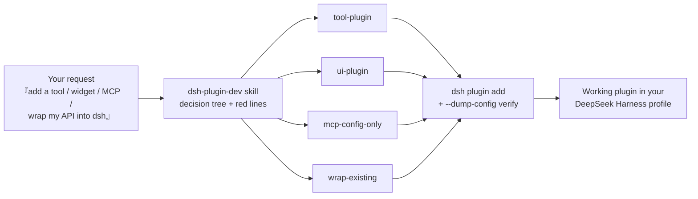

# dsh-plugin-dev-kit

**Skills, templates, and recipes that teach any AI coding agent to build [DeepSeek Harness (dsh)](https://github.com/deepseek-ai/deepseek-harness) plugins — fast, correctly, and without fighting the framework.**

English | [中文](README.zh.md)

[](https://github.com/mahingbun-dev/dsh-plugin-dev-kit/actions/workflows/ci.yml)
[](LICENSE)




## Why this exists

DeepSeek Harness is an **all-plugin** agent harness: the model adapters, the
tool registry, the session log, even the agent loop itself are plugins
composed from YAML patch layers. That makes it uniquely extensible — and
uniquely easy to get wrong from the outside:

- a package without `dsh.bundle` **installs but silently never activates**;
- a stateful dsh dependency listed under `dependencies` creates a **second
  instance** nobody shares;
- git-installed plugins need a `prepare` build script **and** a pnpm
  build-script allowance;
- patch overrides **replace** a row's whole `config` — they never merge.

This kit encodes those lessons (and the 12-line red-line list they come from)
into a skill your agent loads, plus copy-paste templates that already avoid
every one of them.

## What's inside

| Asset | What it gives your agent |
| --- | --- |
| `skills/dsh-plugin-dev/SKILL.md` | The workflow: pick the path → inspect APIs → write from template → install → climb the verification ladder |
| `references/` (8 files ×2 languages) | Framework map, tool contract, seam/provider guide, wrap-existing strategies, UI & MCP, testing, pitfalls with fixes, troubleshooting |
| `templates/tool-plugin/` | Minimal model-facing tool, zero build step |
| `templates/ui-plugin/` | Web UI widget (Host + Client halves, slot registration) |
| `templates/mcp-config-only/` | Connect an MCP server with **zero code** |
| `templates/wrap-existing/` | Make an existing HTTP API callable by the agent |
| `examples/dice-tool/` | Complete worked example with standalone tests |
| `install.sh` / `install.ps1` | One-command install into ZCode, Claude Code, or Codex |

## 60-second start

```sh
git clone https://github.com/mahingbun-dev/dsh-plugin-dev-kit
cd dsh-plugin-dev-kit
./install.sh            # Windows: ./install.ps1
```

Then start a **fresh session** in your tool and say:

> Build a dsh plugin that adds a `roll_dice` tool, install it into a profile
> called `demo`, and verify with `--dump-config`.

or in Chinese:

> 用 dsh-plugin-dev 的流程，给我的 dsh 写一个 roll_dice 工具插件，装进 demo
> profile 并用 --dump-config 验证。

The skill triggers, copies `templates/tool-plugin/`, renames it, installs it
via `dsh plugin add`, and verifies the composed config — instead of inventing
a plugin format that doesn't exist.

## Install (per tool)

| Tool | User scope | Project scope | Command |
| --- | --- | --- | --- |
| **ZCode** | `~/.agents/skills/dsh-plugin-dev` | `.agents/skills/` | `./install.sh` |
| **Claude Code** | `~/.claude/skills/dsh-plugin-dev` | `.claude/skills/` | `./install.sh --tool=claude` |
| **Codex CLI** | `~/.codex/skills/dsh-plugin-dev` | — (no project-level skills) | `./install.sh --tool=codex` |

Manual install = copy `skills/dsh-plugin-dev/` into any directory above. All
three tools load the same standard `SKILL.md` format; no build or extra
dependencies are required.

## The three paths

1. **New tool plugin** — the model calls your capability. Start from
   `templates/tool-plugin/`; deep contract in
   [`skills/dsh-plugin-dev/references/tool-plugin.md`](skills/dsh-plugin-dev/references/tool-plugin.md).
2. **Wrap an existing project** — your API/CLI/MCP server stays as is; a thin
   plugin shell exposes it to the agent. See
   [`references/wrap-existing-project.md`](skills/dsh-plugin-dev/references/wrap-existing-project.md)
   (the MCP case needs **zero code**).
3. **Platform capability (seam provider)** — implement or swap shell / fs /
   sandbox / llm adapter / storage behind one of dsh's 30+ capability seams.
   See [`references/seam-provider.md`](skills/dsh-plugin-dev/references/seam-provider.md).

## Golden rules your agent will follow

1. Everything is a plugin; find services by `ctx.<key>` via `inject`, never by
   importing implementations.
2. Every registration returns a disposer — HMR and uninstall unroll cleanly.
3. `waterfall` events are middleware: call `next()` to delegate, return
   without it to veto.
4. Model-visible ⟺ logged: tool results are durable `tool/result` events, so
   return plain JSON values.
5. Composition = profile + ordered bundle patch layers; later layers win per
   row id, replacing the whole `config`.
6. Verify in this order: `--dump-config` → boot result fields → one real
   end-to-end exercise → automated REAL-composition test.

## Requirements & compatibility

- A dsh installation you can run (`dsh --version`) and pnpm for plugin
  installs. Written against dsh **0.1.7-rc.x**; dsh APIs are pre-stable, so the
  skill teaches verification-first habits (`--dump-config`,
  `Config.listConfigs`) rather than memorized signatures.
- Node ≥ 20 for the templates and tests (ESM, plain JavaScript — no build step).
- Codex skills support is [experimental](https://community.openai.com) (since
  Dec 2025); ZCode and Claude Code load skills natively.

## FAQ

**Does this work without access to DeepSeek's npm registry?**
Installing a *local checkout* plugin (`dsh plugin add ./your-plugin`) never
hits a registry: dsh packages live in `peerDependencies`, which the running
installation satisfies. You only need a reachable registry if your plugin adds
third-party `dependencies` or you want devDependency copies for your IDE.

**Is this an official DeepSeek project?**
No — it is a community kit distilled from the public dsh docs, the dsh
product's own `cordis-plugin-development` skill, and source reading. The
authoritative references remain the [dsh docs](https://github.com/deepseek-ai/deepseek-harness).

**My plugin is a TypeScript project.**
Ship plain ESM JavaScript for the zero-build path (as the templates do), or
add a `prepare` script that builds `lib/` — required anyway for git installs
(see pitfall P3 in `references/pitfalls.md`).

**How do I verify a plugin without an API key?**
`dsh --profile <name> --dump-config` is keyless and proves composition. The
skill's verification ladder starts there precisely so you can gate most work
before any model call.

## Contributing

Issues and PRs welcome — see [CONTRIBUTING.md](CONTRIBUTING.md). If dsh ships
a change that invalidates a template or red line, an issue with the new
behavior is the most useful contribution possible.

## License

[MIT](LICENSE) © 2026 mahingbun-dev
