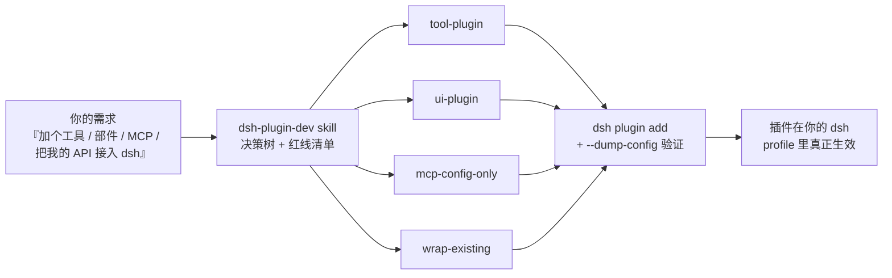

# dsh-plugin-dev-kit

**教会任何 AI 编码代理快速、正确地开发 [DeepSeek Harness (dsh)](https://github.com/deepseek-ai/deepseek-harness) 插件的 skill、模板与配方——不与框架较劲。**

[English](README.md) | 中文

[](https://github.com/mahingbun-dev/dsh-plugin-dev-kit/actions/workflows/ci.yml)
[](LICENSE)




## 为什么需要它

DeepSeek Harness 是**一切皆插件**的 agent harness：模型适配器、工具注册表、session 日志、乃至 agent loop 本身都是插件，由 YAML patch 层组合而成。扩展能力极强——但从外部入手极易踩坑：

- 没有 `dsh.bundle` 声明的包**装得上但静默永不激活**；
- 有状态的 dsh 依赖写进 `dependencies` 会产生**谁也共享不到的第二个实例**；
- git 安装的插件需要自带 `prepare` 构建脚本**且**要用户放行 pnpm 构建脚本；
- patch 覆盖**整行替换** `config`，从不合并。

本工具箱把这些教训（以及它们背后的 12 条红线清单）编码进 agent 可加载的 skill，并配上已避开全部红线的复制即用模板。

## 内容一览

| 资产 | 给你的 agent 什么 |
| --- | --- |
| `skills/dsh-plugin-dev/SKILL.md` | 工作流：选路径 → 探查 API → 从模板写 → 安装 → 爬验证阶梯 |
| `references/`（8 篇 × 双语） | 框架地图、工具契约、接缝/Provider 指南、套壳策略、UI 与 MCP、测试、带修法的红线清单、排障树 |
| `templates/tool-plugin/` | 最小模型工具插件，零构建 |
| `templates/ui-plugin/` | Web UI 部件（Host + Client 两半、slot 注册） |
| `templates/mcp-config-only/` | **零代码**接入 MCP 服务器 |
| `templates/wrap-existing/` | 让 agent 能调用既有 HTTP API |
| `examples/dice-tool/` | 完整可跑的示例插件（带独立测试） |
| `install.sh` / `install.ps1` | 一条命令装进 ZCode、Claude Code 或 Codex |

## 60 秒上手

```sh
git clone https://github.com/mahingbun-dev/dsh-plugin-dev-kit
cd dsh-plugin-dev-kit
./install.sh            # Windows: ./install.ps1
```

然后在你的工具里开**新会话**，直接说：

> 用 dsh-plugin-dev 的流程，给我的 dsh 写一个 roll_dice 工具插件，装进 demo
> profile 并用 --dump-config 验证。

skill 会触发：复制 `templates/tool-plugin/`、改名、经 `dsh plugin add` 安装、验证组合配置——而不是发明一个不存在的插件格式。

## 安装（分工具）

| 工具 | 用户级 | 项目级 | 命令 |
| --- | --- | --- | --- |
| **ZCode** | `~/.agents/skills/dsh-plugin-dev` | `.agents/skills/` | `./install.sh` |
| **Claude Code** | `~/.claude/skills/dsh-plugin-dev` | `.claude/skills/` | `./install.sh --tool=claude` |
| **Codex CLI** | `~/.codex/skills/dsh-plugin-dev` | —（无项目级 skills） | `./install.sh --tool=codex` |

手动安装 = 把 `skills/dsh-plugin-dev/` 拷进上述任一目录。三端加载同一份标准 `SKILL.md` 格式，无需构建、无额外依赖。

## 三条路径

1. **新工具插件**——模型调用你的能力。从 `templates/tool-plugin/` 起步；完整契约见
   [`skills/dsh-plugin-dev/references/tool-plugin.md`](skills/dsh-plugin-dev/references/tool-plugin.md)（中文镜像 `zh/tool-plugin.zh.md`）。
2. **套壳接入已有项目**——你的 API/CLI/MCP 服务保持原样，薄插件壳把它暴露给 agent。见
   [`references/wrap-existing-project.md`](skills/dsh-plugin-dev/references/wrap-existing-project.md)（MCP 情形**零代码**）。
3. **平台能力（接缝 Provider）**——在 dsh 的 30+ 能力接缝之一后面实现或替换 shell / fs / 沙箱 / llm 适配器 / 存储。见
   [`references/seam-provider.md`](skills/dsh-plugin-dev/references/seam-provider.md)。

## 你的 agent 会遵守的黄金法则

1. 一切皆插件；经 `inject` 按 `ctx.<key>` 查服务，绝不 import 实现。
2. 每个注册都返回 disposer——HMR 与卸载干净回滚。
3. `waterfall` 事件是中间件：调 `next()` 委托，不调即否决。
4. 模型可见 ⟺ 已记录：工具结果是持久化 `tool/result` 事件，返回纯 JSON 即可。
5. 组合 = profile + 有序 bundle patch 层；后层按行 id 胜出，整行替换 `config`。
6. 按序验证：`--dump-config` → 启动结果字段 → 一次真实端到端 → 自动化 REAL-composition 测试。

## 环境要求与兼容性

- 一个能跑的 dsh 安装（`dsh --version`）与 pnpm（插件安装用）。内容基线为 dsh
  **0.1.7-rc.x**；dsh API 预稳定，因此 skill 教的是「验证优先」习惯（`--dump-config`、`Config.listConfigs`）而非背签名。
- Node ≥ 20（模板与测试；ESM、纯 JavaScript、零构建）。
- Codex 的 skills 支持[尚为实验特性](https://community.openai.com)（2025-12 起）；ZCode 与 Claude Code 原生加载 skills。

## FAQ

**没有 DeepSeek npm registry 的访问权也能用吗？**
安装**本地目录**插件（`dsh plugin add ./your-plugin`）完全不走 registry：dsh 包都在
`peerDependencies` 里，由运行中的安装满足。只有当你的插件引入第三方
`dependencies`、或想要 devDependency 副本供 IDE 使用时才需要可达的 registry。

**这是 DeepSeek 官方项目吗？**
不是——这是社区工具箱，内容蒸馏自公开的 dsh 文档、dsh 产品自带的
`cordis-plugin-development` skill 与源码阅读。权威参考仍是
[dsh 文档](https://github.com/deepseek-ai/deepseek-harness)。

**我的插件项目是 TypeScript 的。**
零构建路径请交付纯 ESM JavaScript（模板即如此），或加一个构建出 `lib/` 的
`prepare` 脚本——git 安装本来也需要它（见 `references/pitfalls.md` 的 P3）。

**没有 API key 怎么验证插件？**
`dsh --profile <name> --dump-config` 免 key，且能证明组合正确。skill 的验证阶梯特意从这里开始，让你在调用模型之前就能卡住大部分错误。

## 参与贡献

欢迎 Issue 与 PR——见 [CONTRIBUTING.md](CONTRIBUTING.md)。如果 dsh 的变更使某个模板或红线失效，提交一个描述新行为的 issue 就是最有价值的贡献。

## 许可证

[MIT](LICENSE) © 2026 mahingbun-dev
